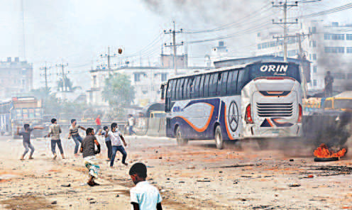

# RMG unrest flares

**Workers clash with law enforcers, block highway; production halted in nearly 450 factories**

_STAFF CORRESPONDENT — Front Page — PDF p1, p2_

*RMG workers vandalise a bus in Gazipur. PHOTO: MEHEDI HASAN*

Garment workers took to the streets again in Dhaka, Gazipur and Savar yesterday, demanding a minimum monthly wage of Tk 30,000.

The unrest has entered its third week. Although normalcy was gradually returning, fresh protests erupted after the wage board postponed its third meeting on Monday (November 16).

The demonstrations triggered repeated clashes between workers and police, road blockades and severe traffic congestion across several industrial belts. Police fired tear gas shells and sound grenades to disperse the protesters.

A notice issued yesterday said the minimum wage board for RMG workers will hold its third meeting at 11:130am November 23 at its office in the capital’s Segunbagicha.

The announcement came a day after the board postponed Monday’s meeting amid labour unrest in major garment industrial zones.

A vice-president of the Bangladesh Garment Manufacturers and Exporters Association (BGMEA), speaking on condition of anonymity, said production was halted at nearly 450 factories across major industrial zones yesterday as workers either stayed away from work or walked out shortly after arriving in the morning.

Meanwhile, our correspondents, quoting industrial police officials and protesters, reported that at least 250 garment factories in Savar, Ashulia and Hemayetpur, and another 60 in Gazipur, remained closed yesterday.

Babul Akhter, workers’ representative on the wage board, and Nazma Akter, president of Sommolito Garments Sramik Federation, attributed the renewed agitation to the postponement of the board’s third meeting.

“I will say again that while the wage board is working to fix the wages, both workers and owners should return to their workplaces and behave responsibly,” Babul said.

The protests also disrupted traffic on stretches of the Dhaka-Mymensingh and Dhaka-Aricha highways.

Meanwhile, 42 platoons of Border Guard Bangladesh (BGB) were deployed across industrial zones in Dhaka, Gazipur and Narayanganj to maintain security, said BGB Public Relations Officer Mohammad Shariful Islam.

According to witnesses and police, several hundred garment workers carrying sticks gathered in Mirpur-1 around 9:00am before marching towards Mirpur-10 in an attempt to block the road.

Police intercepted the procession in front of Mirpur Model Police Station. Tensions escalated when some protesters tried to breach the barricade, prompting law enforcers to fire tear gas shells and sound grenades. The workers dispersed into nearby alleys.

Jahidul Islam, additional deputy commissioner of Dhaka Metropolitan Police’s Mirpur division, said police repeatedly asked the workers to put down their sticks and disperse peacefully.

“However, when the workers tried to breach the barricade and cause disorder, law enforcers fired tear gas shells and sound grenades to disperse them for public safety and to ease commuters’ suffering,” he said, adding that several people were detained at the scene.

Workers also blocked roads beneath the Mirpur-11 metro rail station, pressing the same demand.

Earlier, several factories in Pallabi’s Section-7 declared a “general holiday” around 8:30am, prompting most workers to head home.

However, some continued demonstrating beneath the Mirpur-11 metro station before marching towards Mirpur-10 and Mirpur-1.

In Gazipur, garment workers staged a series of demonstrations, blocking the Dhaka-Mymensingh Highway at several points.

Workers from multiple factories in Bhogra stopped work around 10:00am and took to the streets. They later blocked the highway at Banglabazar, Bagher Bazar, Shirishchala and Garagaria Masterbari in Sreepur.

The blockades brought highway traffic to a standstill from 10:00am to 3:00pm.

Law enforcers fired sound grenades and tear gas shells to disperse the protesters.

Mohammad Amjad Hossain, superintendent of Gazipur Industrial Police-2, said traffic resumed normally after 3:00pm. Eleven factories along the highway declared a general holiday following the unrest, he added.

Meanwhile, Mamun Hossain, 23, a reporter for the daily Kalbela, was injured while covering the protests near the Bhogra Bypass flyover in Gazipur.

A sound grenade exploded near his right foot around 10:30am, injuring his leg and ear. Colleagues took him to the emergency department of Dhaka Medical College Hospital, where he was receiving treatment.

In Savar, garment workers blocked the Dhaka-Aricha Highway to press home their demands.

Workers gathered at Padmar Mor in Hemayetpur around 9:30am. When police and BGB personnel attempted to clear the road, protesters hurled bricks and stones at them, prompting police to fire tear gas shells and sound grenades to disperse the crowd.

Workers from several factories also blocked the highway at Rajfulbaria, causing severe traffic congestion.

Law enforcers cleared the road near Fulbaria around 12:15pm, allowing traffic to resume.

Savar Model Police Station Officer-in- Charge Mohammad Saiful Alam said 11 cases had been filed over the unrest and 117 people arrested since the protests began on October 31.

He alleged that members of various organisations, including banned outfits, had infiltrated the workers’ movement to incite violence, adding that police were conducting drives to identify them.

He also said no casualties were reported during yesterday’s demonstrations, adding that two platoons of BGB personnel had been deployed in Savar to maintain order.

### NEW WAGE FROM DEC 1

Wage board Chairman Syed Azad Subhani yesterday said the new pay scale for garment workers would be announced as soon as possible and implemented from December 1.

“Workers will receive their revised salaries in January 2027,” he said at a press briefing at the wage board office in Dhaka’s Segunbagicha.

Subhani said the postponement of the board’s third meeting, originally scheduled for Monday, had caused confusion among workers.

He said the meeting had been rescheduled for November 23, when the board would discuss wage proposals from workers’ and owners’ representatives to determine the final amount.

“Once the amount is finalised, the board must allow 14 days for opinions, objections or appeals from either party. The board also has the authority to extend this period,” he said, adding that the revised wage scale would take effect from December 1, regardless of the amount finalised.
