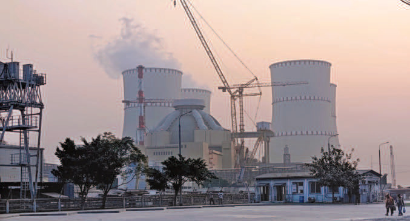

# Atomic power flows into national grid

**Rooppur first unit feeds up to 350MW in trial run**

_AHMED HUMAYUN KABIR TOPU and ASIFUR RAHMAN — Front Page — PDF p1, p2_

* PHOTO: PID*

Bangladesh took a major step towards joining the league of nuclear power-producing countries yesterday as the first unit of the Rooppur Nuclear Power Plant began feeding electricity into the national grid on a trial basis, nearly nine years after construction began.

The unit initially supplied up to 350 megawatts (MW) before its output was reduced to 300MW to maintain grid stability, according to the science and technology ministry.

The first grid synchronisation took place at 3:16pm, marking a major milestone for the Tk 1.39 lakh crore project in Pabna.

“This is a historic achievement,” said Science and Technology Minister Fakir Mahbub Anam, who was present at the plant.

The development, however, does not mean the plant has entered commercial operation. Unit 1 must undergo several rounds of technical tests and regulatory checks before it can supply electricity commercially at full capacity.

Project Director Md Kabir Hossain said the initial grid connection would last around eight to 10 hours, after which the unit would be disconnected for further tests.

It would be reconnected after a break of about 28 hours, initially supplying electricity for four to six hours.

The tests will assess the performance of the turbine, generator, control systems and equipment connecting the plant to the national grid. Output will be raised or lowered, and the unit may be temporarily disconnected as required.

Electricity generated during the testing period can be used by consumers, but uninterrupted supply cannot yet be guaranteed. Power Grid Bangladesh PLC will manage grid balance, while the Bangladesh Power Development Board (BPDB) will monitor the supply.

The project director said the plant would need approval from the Bangladesh Atomic Energy Regulatory Authority (BAERA) before entering the next phase of trial operation.

Generation would then gradually increase towards the unit’s full capacity of 1,200MW, a process that could take several months.

The minister expressed hope that the unit would reach full capacity by late January or early February next year.

That would not necessarily mean the start of permanent commercial operation, however.

Under the agreement with the Russian contractor, Unit 1 must undergo a 10-month trial operation before beginning permanent commercial electricity supply at full capacity.

After the trial, the contractor is expected to provisionally hand over the unit to the Bangladesh Atomic Energy Commission (BAEC).

The Nuclear Power Plant Company Bangladesh Limited (NPCBL) will subsequently operate the plant as its designated operating organisation, subject to the required government notification.

“The first grid synchronisation was successful and the national grid remained stable,” said BPDB Member (Generation) Md Zahurul Islam.

He said the grid had been prepared to receive electricity from the Rooppur plant and that the additional supply would help meet rising demand.

### LONG-AWAITED MILESTONE

The Rooppur plant is being implemented by the BAEC, with Atomstroyexport, a subsidiary of Russian state-owned nuclear corporation Rosatom, serving as the contractor.

It has two VVER-1200 reactors, each with a gross generation capacity of 1,200MW, giving the plant a combined capacity of 2,400MW.

While Unit 1 has entered the grid-synchronisation and testing phase, construction of Unit 2 is still underway.

Construction of the first unit began in November 2017, with the original completion deadline set for December 2025. The deadline was extended twice, most recently to June 2028.

The plant is expected to diversify Bangladesh’s power generation mix, which remains heavily dependent on natural gas, imported coal and furnace oil.

### COST, TARIFF

The milestone comes amid questions over the project’s rising cost and the price at which BPDB will purchase electricity from the plant.

The project cost has climbed to Tk 1.39 lakh crore, around Tk 26,000 crore above the previous estimate, partly due to the depreciation of the taka against the US dollar. Around 90 percent of the cost is being financed through a Russian state loan.

The electricity tariff has yet to be finalised.

BPDB initially estimated a purchase price of Tk 6.72 per unit, but officials have indicated that it could rise to around Tk 10 after a review of construction, operation and maintenance costs.

BPDB Chairman Rezaul Karim earlier told The Daily Star that the board had sought detailed information on these costs before finalising the purchase price.

### A DREAM COME TRUE

The idea of establishing a nuclear power plant in Bangladesh dates back more than six decades. The proposal was first made in 1961, and Rooppur was selected as the site in 1963. Several proposals and feasibility studies followed, but construction did not begin until November 2017.

For 65-year-old Amirul Islam, a retired schoolteacher from Rooppur village, the start of electricity generation marks the fulfilment of a childhood dream.

“Since my childhood, I have been hearing that a nuclear power plant would be established here in Rooppur. We had a dream of seeing the plant become a reality. Now that dream has come true as the plant has started feeding electricity into the national grid,” he said.

“As residents of the area around the nuclear plant, we feel proud. Now our demand is uninterrupted electricity supply at an affordable rate.”

Md Mojnu, a tea-stall vendor in the area, said local people had initially been apprehensive about the plant because of fears surrounding nuclear energy.

“We have overcome our fear of the nuclear plant. Now we feel proud of it,” he said, adding that the project had transformed the locality.

*Police fire tear gas to disperse garment workers who blocked the road in the Bhogra Bypass area of Gazipur yesterday, demanding a wage increase. The protests triggered repeated clashes between workers and police, as well as road blockades in several industrial belts. The workers’ unrest is in its third week. PHOTO: MEHEDI HASAN*

> “As residents of the area around the nuclear plant, we feel proud. Now our demand is uninterrupted electricity supply at an affordable rate.”
