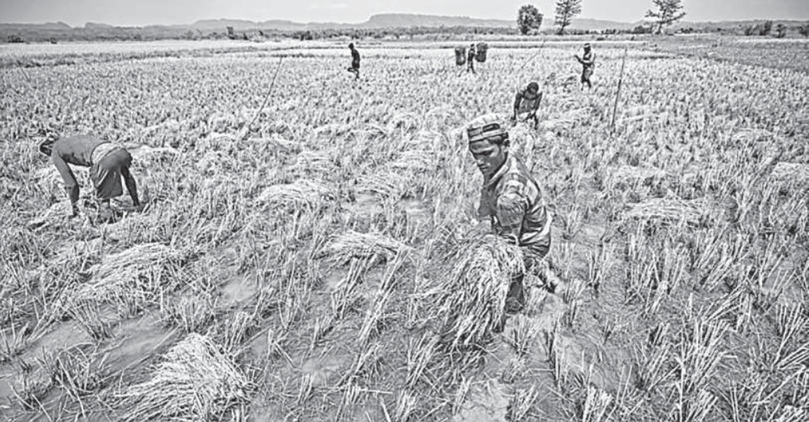

# Building a resilient food system is key to our future food security

_Editorial — PDF p6_

Bangladesh’s food security is facing growing uncertainty as warnings of possible disruptions to global food supplies and volatility in international markets raise concerns about future food availability and prices. Persistent inflation, limited employment opportunities, and climate-related shocks are putting further pressure on household budgets, making it harder for families to afford food. The country has made significant progress towards the goal of zero hunger in recent decades, but these gains don’t guarantee that it can sustain this progress amid changing global and domestic situations. The key question is whether its food system can withstand these pressures while ensuring that people continue to have access to adequate and nutritious food.

Bangladesh faces pressures on both food supplies and people’s ability to pay. Although the country has made considerable progress in domestic food production, sustaining the progress is becoming increasingly difficult. A 2025 study by Bangladesh Institute of Development Studies points to rising agricultural input and irrigation costs, pressure on agricultural land, water management constraints, and recurring climate-related shocks as major challenges. The country also relies heavily on imported food and essential commodities, leaving it exposed to global supply disruptions, geopolitical tensions, and fluctuations in international markets.

The latest outlook of the United Nations Food and Agriculture Organization (FAO) forecasts the second-largest global cereal harvest on record. However, it also projects a 3.5 percent decline in the global cereal trade in 2026-27, partly due to disruptions to shipping through the Black Sea. An earlier FAO outlook has also highlighted the risk of El Niño and conflict-related volatility in energy and fertiliser markets. These developments are significant for Bangladesh because they can raise the cost of food imports as well as agricultural production at home, putting subsequent pressure on domestic food prices and household purchasing power.

The pressure is already visible in household finances. The Living Standard Survey 2025 by Bangladesh Bureau of Statistics found that average monthly household expenditure exceeded income by Tk 1,798. More than 47 percent of surveyed households also reported borrowing to meet their living expenses during the previous year. These findings suggest that many households have little financial room to cope with further increases in living costs. As prices continue to rise, they may also have less money available to spend on food.

These constraints can also affect the quality of food that people consume. With the household budgets getting tighter, families may have to rely more on cheaper staple foods and cut back on nutritious options such as meat, fish, eggs, milk, fruits, and vegetables. This can reduce dietary diversity and make it harder for people to maintain a healthy diet, or even meet basic food needs. According to UN estimates, 6.78 crore people in Bangladesh were unable to afford a healthy diet in 2025. This reflects why food security cannot be measured simply by the availability of food; rather, it depends on whether people can afford an adequate and nutritious diet.

Household purchasing power is not the only factor affecting food affordability. The prices that consumers pay are also influenced by how food moves through domestic supply chain mechanisms. A recent study by the Centre for Policy Dialogue revealed considerable differences between the prices farmers receive and the prices consumers pay for several essential commodities. These differences partly reflect the costs of transportation, storage, processing and distribution. However, limited price transparency and weak market oversight can make it difficult to distinguish legitimate costs from excessive profit margins and unfair trading practices. When such problems push up consumer prices, they further challenge people’s ability to afford food.

Against this backdrop, government support is essential to protect vulnerable households from food price pressures. Bangladesh’s public food stocks stood at 21.47 lakh tonnes as of November 15, 2026. However, maintaining substantial food reserves does not necessarily mean that vulnerable households can access food at affordable prices. Food grain distribution at subsidised rates fell by 7 percent in July- September 2026, compared with the same period last year. Distribution through the Open Market Sale (OMS) programme fell by 22 percent over the same period. Moreover, the World Bank’s latest development update, published in October, indicates that about half of the country’s poorest households remain outside any social protection programme. These figures raise an important question: are existing government support reaching the people who need them the most?

Preparing Bangladesh for the future food disruptions will require strengthening the resilience of its food system. Expanding domestic production beyond rice and putting a greater emphasis on pulses, oilseeds, fisheries, livestock, vegetables, and fruits will be key to building a more diversified food supply. The country also needs varied sources from which to import food as well as improve import planning. Better storage and post-harvest handling, transparent pricing, and efficient supply chains can also help reduce the gap between farm-gate and retail price. Climate-smart farming and better access to agricultural technologies will also help sustain the food production even as the conditions change.

Delivering these priorities will require effective coordination among the various ministries and institutions responsible for food security, agriculture, nutrition, and social protection. The country’s National Food and Nutrition Security Policy recognises the importance of cross-sectoral coordination, institutional capacity, and partnerships. Its Plan of Action (2021- 2030) also emphasises stronger monitoring and involvement of the local institutions and non-state actors. However, the challenge is to translate these policy commitments into more coordinated actions, at both local and national levels.

The future of Bangladesh’s food security will depend on how well its food system responds to growing geopolitical, economic, and environmental pressures. The household purchasing power, affordability of nutritious food, proper market governance, and support to vulnerable households will also shape our ability to navigate these challenges. Preparing for uncertainty, hence, calls for reliable food supplies, affordable prices, and effective measures to ensure people’s access to adequate and nutritious food.

*Persistent inflation, limited job opportunities, and climate-related shocks are making it more difficult for families to afford adequate and nutritious food in Bangladesh. FILE PHOTO: RAJIB RAIHAN*

> A recent study by the Centre for Policy Dialogue revealed considerable differences between the prices farmers receive and the prices consumers pay for several essential commodities. These differences partly reflect the costs of transportation, storage, processing and distribution. However, limited price transparency and weak market oversight can make it difficult to distinguish legitimate costs from excessive profit margins and unfair trading practices.
