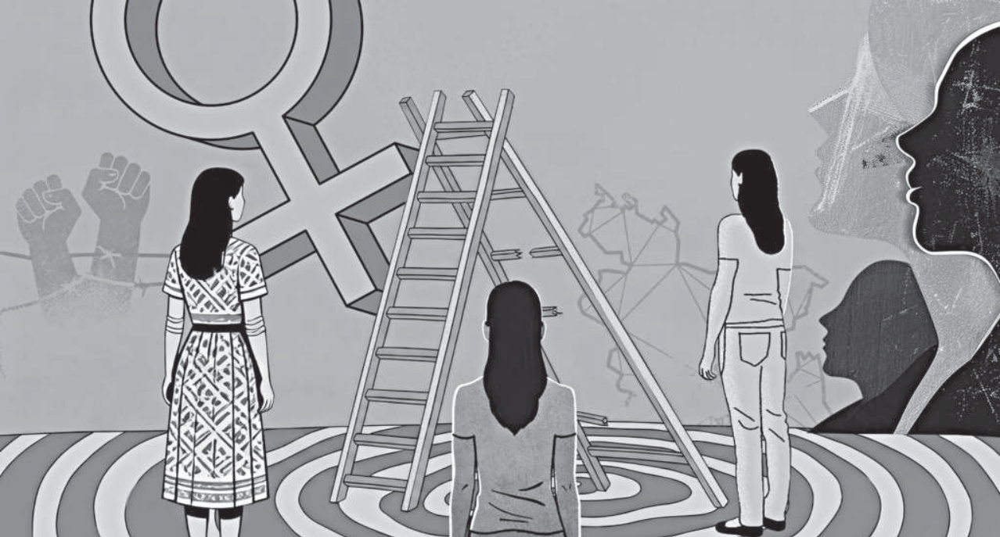

# Promoting women’s leadership is not enough. Barriers to their advancement must be removed

_Opinion — PDF p7_

The World Economic Forum’s Global Gender Gap Report 2026 presents a troubling picture of women’s economic opportunities in Bangladesh. Although the country has closed 96.1 percent of its educational gender gap, it is ranked 142nd out of 145 countries in economic participation and opportunity. Women occupy only 6.2 percent of positions classified as legislators, senior officials and managers, while just 3.6 percent of firms have female top managers. These figures expose a fundamental disconnect between progress in women’s education and their opportunities to advance professionally.

While discriminatory social norms and unequal caregiving responsibilities remain significant barriers to women’s success, organisational policies and practices also deserve scrutiny. Recruitment, performance assessment, promotion criteria and workplace arrangements disadvantage women, even when organisations publicly express their commitment to gender equality.

Companies in Bangladesh and elsewhere continue to invest resources in gender training, awareness workshops, and capacity-building programmes. Many of us have participated in such sessions. Organisations usually report how many employees have been trained, but how often do they examine whether these investments have improved women’s career progression or representation in leadership roles?

An interesting experience from the United States offers an alternative approach. During the 1970s and 1980s, several major symphony orchestras introduced blind auditions, requiring musicians to perform behind screens so selection committees could not identify their gender. Research by economists Claudia Goldin and Cecilia Rouse found that this change significantly improved women’s chances of advancing through certain stages of recruitment. Women’s representation in leading orchestras also increased substantially over the following decades.

Rather than relying on gender sensitisation workshops or training, the orchestras redesigned their recruitment procedures to reduce opportunities for bias. The lesson is compelling: changing organisational systems can sometimes be more effective than trying to change individual attitudes.

This does not mean gender awareness is unnecessary. Understanding discrimination and challenging harmful socioeconomic norms remain important. However, awareness does not automatically translate into behavioural change. Even employees who genuinely believe in gender equality may make decisions influenced by unconscious biases. Training alone cannot overcome organisational systems that perpetuate inequality.

Behavioural economist Iris Bohnet makes this argument in her influential book What Works: Gender Equality by Design. Drawing on behavioural economics, psychology and organisational research, she demonstrates that achieving gender equality requires intentionally redesigning institutional policies and practices. Her more recent book, Make Work Fair: Data-Driven Design for Real Results, co-authored with Siri Chilazi, reinforces the importance of embedding fairness in recruitment, performance management, promotion and everyday workplace practices.

Some organisations have put these principles into practice. Unilever worked with Iris Bohnet to develop a gender appointment ratio, enabling senior leaders to examine their records of appointing women and men over five years and identify potential biases. The multinational company also introduced more balanced candidate shortlists and reviewed policies affecting women’s career progression. Similarly, the BBC’s 50:50 Equality Project demonstrated the value of measurable targets. By systematically tracking the gender of expert contributors, one BBC programme increased women’s representation from 39 to 51 percent within three months.

These examples offer valuable lessons for Bangladesh. In my professional life, I have witnessed that many qualified women enter employment but struggle to advance. Their limited representation in senior management cannot simply be attributed to a lack of ambition, confidence or leadership capabilities. We must also examine whether organisational systems provide genuinely equal opportunities.

Consider recruitment and promotion. Decisions often depend on subjective assessments of leadership potential, confidence, communication styles, or perceived suitability. Such judgements can be influenced by gender stereotypes. Assertiveness may be interpreted as leadership in men but viewed negatively in women. Assumptions about women’s family responsibilities may also influence decisions about assigning challenging roles or considering them for promotion.

Relatively straightforward changes can reduce these biases. Structured interviews, standardised assessment criteria, diverse selection panels, and transparent promotion procedures can make decisions fairer. Candidates for promotions should be evaluated against clearly defined competencies and evidence of performance, rather than subjective impressions.

Performance management deserves similar attention. Are women and men assessed against the same standards? Do managers reward employees who remain in the office late, even when longer hours do not necessarily indicate greater productivity? Are employees who travel frequently or participate in informal networking more likely to receive favourable evaluations? Such practices can disadvantage women in Bangladesh, where unpaid care and household responsibilities fall disproportionately on them. Even highly capable women may struggle to meet expectations built around employees with few responsibilities outside work.

Organisations often encourage women to become more confident, negotiate better, and develop leadership skills while maintaining workplace arrangements that make advancement difficult. What happens when promotion requires frequent travel, geographical mobility, unpredictable working hours, or participation in male-dominated informal networks?

Instead of treating these as individual women’s problems, organisations should reconsider how jobs and leadership roles are designed. Flexible working arrangements, predictable schedules, equitable parental leave, childcare support, and fair access to career-enhancing assignments can help remove structural barriers. Family-friendly policies should benefit both women and men, encouraging a more equitable distribution of caregiving responsibilities.

Bohnet and Chilazi recommend a practical framework: make fairness count, make fairness stick, and make fairness normal. This involves using data to identify inequalities, redesigning organisational systems to address them, and embedding equitable practices into everyday operations.

For organisations in Bangladesh, a useful starting point would be a gender audit of recruitment, retention, compensation, performance assessments and promotions. How many women enter at junior levels? What proportion reach middle and senior management? At which stages do women leave or stop progressing? Are equally qualified women and men promoted at comparable rates? The findings should guide concrete changes, supported by measurable targets and leadership accountability. Gender equality must not remain the responsibility of human resources departments or designated gender focal points alone. Senior management should be held accountable for creating equitable workplaces, just as they are for financial and operational performance. Organisations must also evaluate whether their interventions produce meaningful results.

It is time to reconsider how we invest in workplace gender equality. Instead of repeatedly training women to navigate unfair systems, or training managers without changing the rules under which they operate, we must redesign those systems themselves.

> While discriminatory social norms and unequal caregiving responsibilities remain significant barriers to women’s success, organisational policies and practices also deserve scrutiny. Recruitment, performance assessment, promotion criteria and workplace arrangements disadvantage women, even when organisations publicly express their commitment to gender equality.
