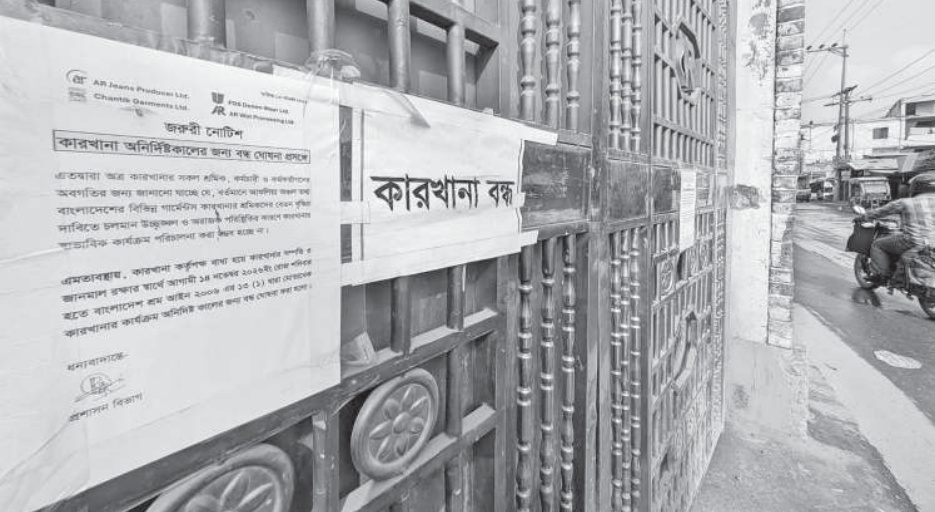

# When factory machines go quiet, who pays? An investor’s perspective

_Opinion — PDF p7_

The current work stoppages in garment factories, amid protests by workers, are not just about wage disputes. They are testing whether Bangladesh can actually sustain the industry that feeds 40 lakh workers and their families.

Since late October, many garment factories across the country—at times over 500—have had to shut their gates on and off, in the face of the protests. Even yesterday, more than 65 stood still, with some closed indefinitely under Section 13 (1) of the Bangladesh Labour Act, 2006. The protests have seen highways blocked, a police vehicle set alight, more than 50 people injured and two workers dead. The headlines called it unrest; the owners called it a crisis. To the workers, it was about dissent. All three are right. That is exactly the problem. The minimum wage board promised a new structure by December, before its third meeting scheduled for November 16 was postponed. Later, the meeting was rescheduled for November 23. But waiting and watching is not a policy. For this sector, it is a slow death.

Take an ordinary garment sold at $5 FOB (free on board—the point when the manufacturer/seller’s responsibility regarding the product ends and any cost incurred thereafter falls on the buyer). The cost of making this garment has risen from $1.46 in December 2023 to $1.80 today, up 23 percent. Most buyers still pay $5, while every cent of the difference has come out of our margins. Over the past five years, gas has risen by more than 280 percent and electricity by 33 percent (according to Bangladesh Garment Manufacturers and Exporters Association’s newsletter published earlier this year). This year alone, port charges have gone up by 41 percent. Bank interest sits at 14 to 15 percent, export incentives have been cut to 0.3 percent, and US tariffs of 10 to 20 percent have been applied since August 2025. These are stark realities that exporters are dealing with. And no, the weaker taka has not rescued us. Fabric and trims, which account for most of a garment’s price, are bought in dollars, and the slide of taka in 2022 and 2023 was largely passed on through the 56 percent wage increase—from Tk 8,000 to Tk 12,500—in December 2023.

Margins were always thin. For many factories, they have now disappeared into thin air: owners are borrowing at high interest to pay wages and hoping the next order covers the expenses of the last. That is a holding pattern, and holding patterns are always set to end. BGMEA data shows that since January 2023, at least 287 factories have closed and roughly 1,75,000 workers have lost their jobs.

History also bears witness to the fact that we did not help ourselves either. For years, big factories priced their products to keep their lines full, at any cost. That habit has been the final nail in the exporters’ coffin.

There is another ledger, and it is just as unforgiving. In December 2023, the Tk 12,500 minimum wage was worth about $113. Today, the same wage is worth roughly $101. Prices (average annual inflation) have climbed by around nine percent a year, while the five-nine percent annual increment applies only to the basic wage, not the gross. So, every year, the worker on the floor is quietly earning less. Those who take home Tk 19,000 or 20,000 often do so only by working overtime. Many times, we see our workers wanting to do overtime. That is simply because they have limited or zero options. The number that the workers’ side is putting on the table is not something that the industry can afford. But we cannot argue that their grievance is unreal. Both sides of this arithmetic are being squeezed. The only parties not squeezed are the ones setting the price based on their saleability and profitability, depending on our ease of production. This brings us back to the government, which must carry its share. Every lost day of production reaches a worker’s home long before it reaches our balance sheets. When a factory closes down and exits the business, the wage stops for good. Fish, eggs, and milk may vanish from the worker’s plate. Rent falls behind, the grocer’s credit disappears, and the money sent home stops, so somewhere in Kurigram an ageing parent goes without medicine. The debts shadow the family for years. The longer-term damage is quieter: children are pulled out of school, and some even seek work. Daughters are married off earlier. A woman who had a voice at home because she earned a wage loses both. So when we sit at the wage board, let us remember what is at stake: whether a child stays in school. No wage, however generous on paper, can support a worker whose factory no longer exists.

Beyond the factory gate, the garment sector earned $38.70 billion in FY2025-26, about four-fifths of everything Bangladesh exports. No other sector comes close to this. Therefore, when this industry coughs, the whole economy catches a cold. The banks sense it first, with 32.17 percent of their loans already in default. Then the spinners, dyers, and truckers feel the drain. The port is quickly affected, and then the villages experience the impact. Let us all remember that the buyers are watching too. Let us also bear in mind that we have never won on price alone; so far, we have won by selling reliability.

Every week of closed gates hands a sourcing manager in Europe or the US a reason to try Vietnam or India.

The jobs are already thinning: a million dollars’ worth of exports needed about 220 workers in 2010 and about 90 in 2024. Each disruption makes machines appear safer than people. And as we graduate from LDC status, we need to remind ourselves that Europe will judge our trade preferences on labour rights. Therefore, a wage dispute must be settled at the table, not on the highway or in the courts.

### What must happen now?

Let’s not waste time pointing fingers. Above all, a wait-and-watch policy will kill this sector. With every week of waiting, buyers move orders and another factory shuts.

Thus, there are four things we need to do now: i) The wage board must quickly settle on a revision the industry can actually pay, phased in and matched by buyers; ii) The prices of products must rise. A revision not reflected in the price comes out of margins that are already gone; iii) The government must carry its share: stable, predictable energy prices, cheaper working capital, and a safety net must be put in place so that one lost job does not become one lost family; and iv) Workers’ leaders must keep the movement in workers’ hands. Arson and vandalism hurt the workers most. This is a reality that the leaders should be worried about.

This industry has carried Bangladesh for four decades and has created entrepreneurs whose businesses have contributed to the empowerment of millions of rural women for the first time. If we let it fail, which other sector will pay around Tk 7,000 to Tk 8,500 crore a month to 40 lakh workers?

I leave you with this burning question, to which I myself have no answer.

*‘When a factory closes down and exits the business, the impact reaches a worker’s home long before it reaches the owners’ balance sheets.’ PHOTO: PALASH KHAN*
