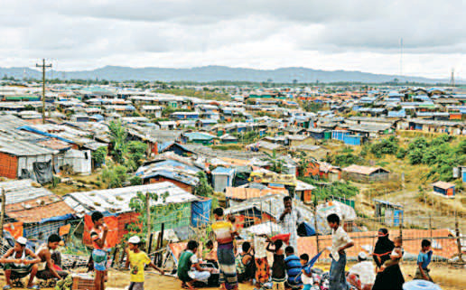

# Rohingyas pin hopes on ICJ genocide ruling

**Many optimistic about justice, but doubts remain over implementation**

_MOKAMMEL SHUVO, Cox’s Bazar — Law & Our Rights — PDF p12, p4_

*A Rohingya camp in Cox’s Bazar. PHOTO: STAR*

Rohingya refugees in Bangladesh are eagerly awaiting the International Court of Justice’s (ICJ) ruling on the genocide case against Myanmar tomorrow, hoping it will bring international recognition of the atrocities committed against them and strengthen their quest for justice.

While Rohingya leaders hope the ruling will help hold perpetrators accountable, many refugees see it as a step towards their long-cherished dream of returning home.

However, nearly a decade of international discussions and diplomatic efforts without tangible progress has left some refugees sceptical about whether the ruling will bring any meaningful change.

Sayed Ullah, first president of the United Council of Rohingya, said the community had waited nearly a decade for justice and hoped for a favourable ruling.

He said refugees were closely following developments, with plans to screen the verdict on a large screen at a field in Jamtholi Rohingya camp.

“We hope the judgment will increase international influence and attention on the Rohingya issue. The international community, particularly the Bangladesh government, needs to maintain its focus and work towards a solution that will allow the Rohingya to return to their homeland,” he said.

Nur Kamal, a refugee living in the camp, said he did not expect any immediate change in their lives but was eagerly awaiting the decision.

Mohammad Zubair, chairman of the Arakan Rohingya Society for Peace and Human Rights, hoped the court would rule in favour of The Gambia and recognise the atrocities against the Rohingya as genocide.

Mujibur Rahaman, founder of the Arakan Rohingya Football Federation, said, “We are positive about the upcoming ruling. We have high hopes that the international community, through the ICJ, will ensure justice for our people. We believe those who persecuted and oppressed us will eventually be brought to justice.”

He, however, stressed that justice and repatriation were separate issues.

Bangladesh’s Refugee Relief and Repatriation Commissioner Mohammad Mizanur Rahman said a ruling recognising the atrocities as genocide would be significant for both the Rohingya and the international community.

“Repatriation will not happen immediately as a direct consequence of the judgment. But it could strengthen the Rohingya’s position and create greater international pressure for their return.”

The ICJ, the UN’s top court, is set to rule on a case brought by The Gambia seven years ago, accusing Myanmar of violating the 1948 Genocide Convention during its military crackdown on the Rohingya.

More than one million Rohingyas remain in Bangladesh after fleeing the 2017 military crackdown in Myanmar’s Rakhine State, amid accounts of mass killings, sexual violence and other atrocities.
