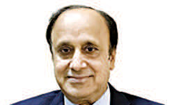

# Fiscal policy is inconsistent with inflation control

_SADIQ AHMED — Star Business — PDF p13, p15_

The BNP government has inherited a difficult economy, further aggravated by the US-Iran war and the associated surge in global energy prices. The blame game, unfortunately, will not buy political capital because people at large will always look to the government in power to deliver results, irrespective of the inherited situation and global turmoil.

While the government faces many challenges, fighting inflation is arguably the most pressing task. The recent US midterm election was a classic example of how the electorate was unforgiving of the missteps of the Trump administration on trade tariffs and the Iran war, which contributed to the rising cost of living and soured the public mood and perception of the commitment and ability of the administration to lower gasoline and other prices. There were other concerns as well, but the cost of living was the most critical factor in the massive decline in the congressional fortunes of the ruling Republican Party.

In Bangladesh, the government is aware of this challenge and has been making efforts to lower inflation. So far, after nine months in power, the results are not reassuring. I have written about this subject several times in recent months and have identified the core issues that need to be addressed to lower inflation sustainably. These include keeping money and credit growth within prudent limits consistent with inflation targets through sound interest rate and fiscal management policies, liberalising imports by removing all types of import controls, lowering the cost of imports by reducing trade tariffs, expanding exports through export diversification, and boosting domestic production and GDP growth through higher public and private investments.

In this article, I will focus on a key message that often escapes the attention of policymakers. Because the government faces many constraints and seeks to achieve multiple, sometimes conflicting, objectives, the policy framework is often neither coherent nor well organised; instead, it is ad hoc and guided more by immediate political convenience, without regard for how consistent it is with the economic objectives and targets being pursued.

The inflation control task, unfortunately, has fallen into this policy inconsistency trap. While the Bangladesh Bank is making efforts to manage the growth of money and credit, the Ministry of Finance is unable to mobilise adequate tax revenue or foreign funding, contributing to a larger-than-desirable level of fiscal deficit and excessive reliance on borrowings from the banking sector to finance it. The credit growth numbers are very telling. Total credit growth climbed from 9.8 percent per year in FY2024 to 10.6 percent in FY2026. It is projected to rise further to 11.2 percent in FY2027. While total credit growth is rising, private sector credit growth has been rapidly decelerating, falling from 9.8 percent in FY2024 to 4.5 percent in FY2026. The GDP growth rate fell from 4.2 percent in FY2024 to 3.5 percent in FY2025, recovering slightly to 4.1 percent in FY2026. The World Bank and the IMF project GDP growth to decline to 3.2 percent and 3.4 percent respectively, in FY2027.

When GDP and private sector credit growth are both falling steeply, what explains the acceleration in total credit growth? This is owing to a sharp increase in the growth of public sector credit, fuelled by rising treasury borrowing from the banking sector to finance the fiscal deficit. The growth in treasury bank borrowing is truly alarming, rising from 9.6 percent in FY2024 to 30.4 percent in FY2026. It is projected to grow further in FY2027.

At a time when domestic economic activity is in serious downturn, as suggested by the severity of the fall in the growth rates of private sector credit and GDP, accelerating public sector credit is simply adding to aggregate demand pressure, fuelling inflation. Clearly, this pace of treasury borrowing to finance the fiscal deficit is not consistent with any credible strategy to fight inflation.

What has gone wrong with fiscal policy? In addition to the long-standing debacle with tax reforms and revenue mobilisation efforts, several developments have put pressure on government expenditure.

First and foremost is the rising energy subsidy bill. The government has raised prices several times to offset the adverse effects of rising global energy prices. Yet these price increases have not been sufficient to arrest the growing energy subsidy bill, which has put considerable pressure on the budget.

Second is the government policy to bail out failing private sector banks through subsidised credit injections to shore up the liquidity base of these banks. There are serious downside risks associated with the sustainability of this policy.

Third is the decision to raise the salaries of the civil service. It is understandable that civil servants are underpaid and deserve a salary boost. The contentious issue is the timing. A delay in the wage award by 12 to 18 months, when the revenue situation would likely have improved, would have been the pragmatic way to proceed.

Policymaking is an art and not a science. Understandably, textbook solutions need to be tempered by political realities to address the issues of the electorate. But what separates skilful policymaking from policymaking guided purely by short-term political expediency is ensuring that the burning economic tasks get top priority, with full consistency of the tools employed to secure them.

In the US, Donald Trump promised his constituency during the 2024 election campaign that he would reduce average gasoline prices to below $2 per gallon and bring inflation down substantially from 3 percent in January 2025. Yet he pursued his tariff policies aggressively and ventured into the Iran war. He did not consider how consistent these policies were with his electoral promises. In the event, gasoline prices soared to an average of $4.50 per gallon, while the inflation rate climbed to 3.7 percent in September 2026.

In the context of Bangladesh, the government is well advised to stick to its commitment to bring inflation down from the current 9-10 percent to between 5-6 percent, and to use all policy instruments consistently. It must reduce treasury borrowing from the banking sector to the minimum possible by relying much more on external borrowing to finance the fiscal deficit, strengthening its revenue mobilisation efforts, cutting energy subsidies, adopting a prudent and sustainable banking sector reform strategy that does not require unsustainable injection of liquidity from the treasury, and phasing in the civil service wage increase over a longer period.
