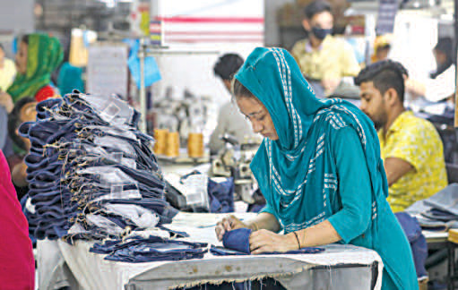

# Basics drive 97% of apparel export growth

**High-value products struggle to gain ground, EPB data shows**

_STAR BUSINESS REPORT — Star Business — PDF p13, p15_

*Apparel exports rose 5.82 percent year-on-year to $13.75 billion in the July-October period. *

Bangladesh’s apparel export growth in the first four months of fiscal year 2026-27 came almost entirely from basic garments, while higher-value products made little headway, underscoring the country’s continued dependence on low-value items.

Apparel exports rose 5.82 percent year-on-year to $13.75 billion in July- October, according to Export Promotion Bureau (EPB) data.

Basic garments accounted for nearly 97 percent of the total increase in export earnings, adding around $730 million to the overall growth of $756 million. Their exports rose 7.27 percent to $10.78 billion, accounting for more than 78 percent of total apparel shipments.

Bottomwear, sweaters and cardigans, and T-shirts and vests were the main growth drivers, together contributing around 82 percent of the increase.

By contrast, semi-basic garments, including shirts and blouses, posted marginal growth, while advanced products grew less than 1 percent.

Exports of advanced garments rose to $1.86 billion, contributing only around $12 million to the overall increase. Gains in outerwear and technical wear were largely offset by declines in dresses, sportswear and suits.

The findings are based on an analysis of EPB data by Mohiuddin Rubel, founder and chief executive officer of Bangladesh Apparel Voice (BAV), who shared the analysis with the media.

The figures suggest that Bangladesh is expanding exports mainly through products in which it already has a strong foothold, rather than making significant progress in higher-value segments.

Fazlee Shamim Ehsan, executive president of the Bangladesh Knitwear Manufacturers and Exporters Association (BKMEA), said the country has the capacity to manufacture higher-value apparel, but production remains limited by inadequate policy support and supply-chain bottlenecks.

Manufacturers face difficulties importing specialised raw materials when they venture into higher-value products. Customs procedures often cause delays, making it difficult to buyers’ delivery deadlines, he said.

Countries such as China and Vietnam have more efficient supply chains and are better equipped to ensure timely delivery. As a result, international buyers often place orders for specialised products with manufacturers in those countries, Ehsan added.

He also said Bangladesh had yet to build a strong reputation among global buyers as a reliable supplier of high-value garments with consistent quality and timely delivery.

Khondaker Golam Moazzem, president of Knowledge Hub Institute, said the existing fiscal incentive structure was encouraging manufacturers to remain dependent on basic garments instead of diversifying into higher-value products.

Exporters receive a 1 percent cash incentive across product categories, along with an additional 2.5 percent incentive for garments made from locally sourced textile materials, irrespective of their level of value addition.

“This simplistic incentive structure is keeping manufacturers tied to basic products while also encouraging buyers to source relatively low-value items from Bangladesh to benefit from the incentives,” he said.

Khondaker called for a major overhaul of the incentive policy, suggesting that support for basic garments be reduced or withdrawn and targeted incentives introduced for higher-value products. He also proposed imposing additional taxes on basic products to discourage further investment in these segments.

He stressed the need to diversify beyond cotton-based garments, saying Bangladesh had yet to tap the substantial global market for non-cotton apparel, where China and Vietnam have established strong positions.

Higher-value products have never accounted for a significant share of Bangladesh’s apparel exports, largely due to inadequate policy support, he said.

Greater opportunities for foreign direct investment could bring in the capital and expertise needed to diversify production and strengthen the country’s position in these segments.
