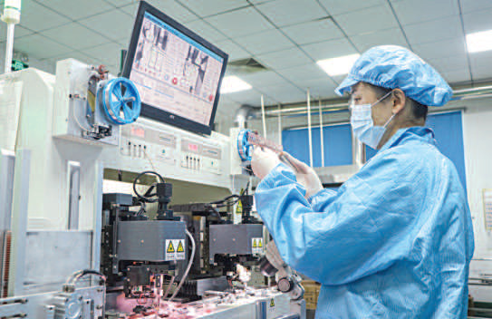

# US to curb China’s access to AI chips as Trump heads to Asia

_REUTERS — Washington — Star Business — PDF p16_

*An employee works at a semiconductor chips factory in Binzhou, in eastern China’s Shandong province. PHOTO: AFP/FILE*

The Trump administration said on Monday it would further restrict China’s access to advanced AI chips from companies like Nvidia, tightening controls as President Donald Trump headed to China for talks with President Xi Jinping.

The effort by the Commerce Department to crack down on overseas data centers and chip smuggling comes amid growing scrutiny of whether the department has been doing enough to keep sensitive technology from China.

The new rule restricts shipments of advanced chips to Southeast Asian countries such as Malaysia, Singapore and Thailand, which Chinese companies have used to access computing power to train AI models.

It also imposes new requirements on overseas data centers that supply significant volumes of computing power to firms headquartered in China.

The rule was published days after Nvidia CEO Jensen Huang resigned after reports of an affair with a suspected Chinese spy who worked at Singapore-based cloud company Megaspeed, an Nvidia partner that rents computing power at its data centers and has come under scrutiny for possible illegal diversion of advanced AI chips to China.

The rule sends a message that America is serious about closing dangerous export control loopholes China has been exploiting for years, John Moolenaar, the Republican chair of the House Select Committee on China, said in a statement.

At a press conference on Tuesday, China’s foreign ministry spokesperson Guo Jiakun said Beijing would take necessary measures to safeguard its own interests and called the US move a typical example of economic coercion that deviates from the consensus reached by both countries.

Trump is due to meet Xi on Thursday in Shenzhen, the southern Chinese city hosting this week’s APEC summit. Trump has previously threatened or imposed technology restrictions on Beijing ahead of high-level meetings.

The new rule identifies Singapore, Thailand, Malaysia, Indonesia and Brazil as countries where advanced chips are at higher risk of being diverted to China. Shipments of covered chips to those countries now require a US export license.

Those requirements do not apply to US companies operating data centers in the five countries.

Commerce Secretary Howard Lutnick, who has faced criticism for his oversight of export controls on chips to China in the wake of the Nvidia scandal, is among administration officials joining Trump on the trip to Asia, a White House official said. Senior White House officials have discussed whether Lutnick should be pushed out, Reuters reported last week.

But Trump told reporters on Monday as he departed the White House for the trip to the Philippines and China that he has no plans to replace Lutnick. More actions against China are likely in the works.

Treasury Secretary Scott Bessent said on Friday that four government agencies had favored putting Megaspeed on a trade blacklist but the Commerce Department, which was in charge, had not.

“It’s a different viewpoint. One wants to be friendly with China and one wants to have a blowup with China,” Trump said on Monday. “They both are acceptable but they are different views.”

Fueling chatter about the dispute, the Commerce Department said in a statement that the new rule was written by the Department of the Treasury and the White House’s National Security Council, which also directed its release.
